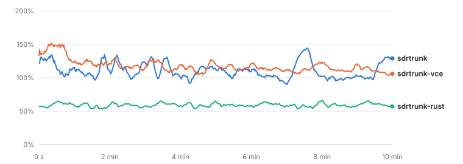
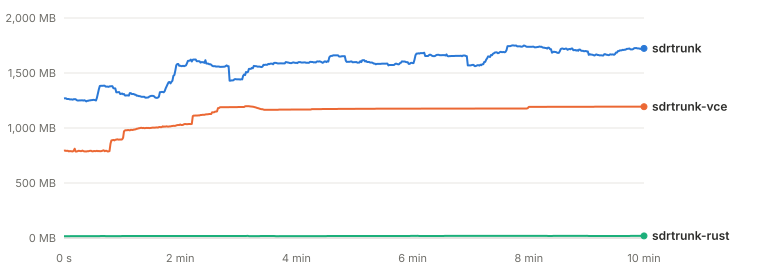
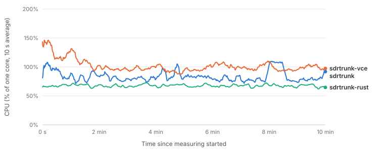
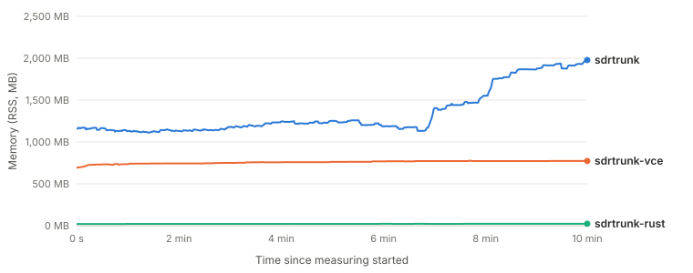

# sdrtrunk-rust

A headless P25 Phase 1 trunking recorder for Linux, written in Rust: a port of the receive, decode and record path of
[sdrtrunk](https://github.com/DSheirer/sdrtrunk), with a web interface for setup and monitoring. It runs well on a
Raspberry Pi 5 and on x86_64.

Inspired by and built against two Java projects: [sdrtrunk](https://github.com/DSheirer/sdrtrunk) by Dennis Sheirer,
whose decoders this ports, and [sdrtrunk-vce](https://github.com/tylerwatt12/sdrtrunk-vce), an enhanced fork of it whose
headless web interface, tuner placement, signal-quality and streaming behaviour sdrtrunk-rust follows.

It follows a P25 control channel, tunes voice channels as calls are granted, decodes the IMBE voice and writes one MP3
per transmission, named and tagged the way sdrtrunk does, so tools that ingest sdrtrunk recordings take them unchanged.
Calls can also be played live to Icecast streams.

## Features

- P25 Phase 1 control and voice channels, C4FM and LSM (simulcast, sdrtrunk's "CQPSK"). DSP, error correction and
  decoding were checked against vectors generated from the Java code.
- Airspy and RTL-SDR tuners; several systems at once, each on its own SDR (pinned or picked automatically).
- Tuner window placed automatically to cover the control channel and the voice frequencies a system uses, moved when a
  call falls outside it; optional lock center and frequency limits; Setup mode to watch a tuner's spectrum.
- Automatic frequency correction (PPM) from the control channel's measured error.
- Recording: clear calls only (encrypted transmissions are never written), per talkgroup on/off, talkgroup lists with
  RadioReference CSV import.
- Icecast streaming: each stream plays the calls of chosen talkgroups (from any alias list) in order, with silence in
  between, now-playing titles, and import of the streams in an sdrtrunk playlist.
- Call event log: one row per call (every talkgroup, encrypted calls included) in sdrtrunk's `*_call_events.log` CSV
  format, a file per system per day, kept 30 days by default (folder and days set on the Recordings page), searchable on
  the Event Log page by system, call type, encryption, emergency, talkgroups, source radio IDs and time range.
- Radio names: names for single radio IDs per talkgroup list, written into each recording's artist tag the way sdrtrunk
  does (`733730"K315"`; file names keep the number) and shown with the number on the dashboard, Event Log page and stream
  titles; imported from an sdrtrunk playlist, where a re-import adds new names and asks before changing yours.
- Health for Uptime Kuma: `GET /health` (all enabled systems) and `GET /health/<system name>` answer `200` when healthy
  and `503` with the reasons (stopped, control channel lost, decode quality, recording errors, tuner missing or
  dropping). No login: keep the web UI on the LAN.
- HTTPS by default (its own certificate, yours, or Let's Encrypt's), plain HTTP only when asked, reverse proxies
  trusted by address; a Connected hosts page for the owner.
- Web UI: dashboard with live calls and signal readouts, tuner spectrum and waterfall, per-channel spectrum, signal and
  decode-quality history, user accounts (owner and admins; the owner allows each admin's changes function by function, and new admins start with none).

Not supported: P25 Phase 2 (TDMA), DMR, NXDN, analog, and decryption.

## Performance comparison

sdrtrunk, sdrtrunk-vce and sdrtrunk-rust, each run alone on a Raspberry Pi 5 (8 GB) for 10 minutes, three times,
following the same two P25 systems and recording the same talkgroups. Each line is a program's three runs averaged
second by second; CPU 100% is one of the Pi's four cores, memory is RSS (physical RAM in use).

**Same signal:** one 175 s recording of both SDRs (a busy afternoon), looped to every program.

| Program | CPU mean | CPU peak | Memory mean | Memory peak |
|---|---|---|---|---|
| sdrtrunk | 110.8% | 211.9% | 1,570 MB | 1,825 MB |
| sdrtrunk-vce | 117.6% | 230.0% | 1,120 MB | 1,205 MB |
| sdrtrunk-rust | 59.1% | 79.3% | 18 MB | 20 MB |

**Live:** the SDRs on the air at night.

| Program | CPU mean | CPU peak | Memory mean | Memory peak |
|---|---|---|---|---|
| sdrtrunk | 83.8% | 207.1% | 1,342 MB | 2,039 MB |
| sdrtrunk-vce | 101.5% | 229.4% | 758 MB | 776 MB |
| sdrtrunk-rust | 67.6% | 84.0% | 22 MB | 23 MB |

Peaks are the mean of each run's peak. The Java programs ran with their desktop windows open; sdrtrunk-rust ran
headless. [BENCHMARK.md](BENCHMARK.md) has the per-run numbers, setup, method and caveats; [bench/](bench/) has the
scripts and raw samples to repeat it.

## Build

Linux with a current stable Rust toolchain (`rustup`), a C compiler, and the Airspy library:

    sudo apt install build-essential libairspy0 librtlsdr2   # librtlsdr0 on older Debian
    cargo build --release -p sdrtrunk-cli

The program is `target/release/sdrtrunk-rust`. The RTL-SDR library is loaded at run time, so it is only needed when an
RTL-SDR is used.

## Run

As a service (the database lives in `/var/lib/sdrtrunk-rust`):

    sudo install -m755 target/release/sdrtrunk-rust /usr/local/bin/sdrtrunk-rust
    sudo install -m644 packaging/sdrtrunk-rust.service /etc/systemd/system/sdrtrunk-rust.service
    # set User= in the unit file to the account that should run it (in the plugdev group for USB access)
    sudo systemctl daemon-reload
    sudo systemctl enable --now sdrtrunk-rust
    journalctl -u sdrtrunk-rust | grep "setup code"

Open `https://<host>/setup` (the browser warns once about the certificate the program made for itself), enter the
setup code from the log and create the owner account. Then add a system
(control channel frequency, modulation, names used in file names) on the Systems page, check the SDR's frequency
correction on the Tuners page, and choose a recordings folder.

Options: `sdrtrunk-rust serve [--db PATH] [--replay DIR]`. `sdrtrunk-rust --freq HZ ...` runs a console monitor
without the web UI.

### HTTPS, ports and reverse proxies

With no settings the web UI serves HTTPS on port 443 and nothing else (no plain HTTP, nothing on 80). The unit reads
these optional variables from `/etc/sdrtrunk-rust/sdrtrunk-rust.env` (make it root-owned, mode 600):

| Variable | Default | Meaning |
|---|---|---|
| `SDRTRUNK_HTTPS` | `0.0.0.0:443` | HTTPS address and port; `off` turns HTTPS off |
| `SDRTRUNK_HTTP` | off | plain HTTP address and port, e.g. `0.0.0.0:8080`, or `127.0.0.1:8080` for a proxy on this machine |
| `SDRTRUNK_TLS_CERT`, `SDRTRUNK_TLS_KEY` | | your PEM certificate (with its chain) and key; both or neither |
| `SDRTRUNK_ACME` | | `web` or `dns-cloudflare`: get and renew Let's Encrypt's certificate |
| `SDRTRUNK_ACME_NAMES` | | the names for Let's Encrypt, comma-separated |
| `SDRTRUNK_CLOUDFLARE_TOKEN` | | API token with Zone, DNS, Edit on the names' zone (for `dns-cloudflare`) |
| `SDRTRUNK_ACME_DIRECTORY` | Let's Encrypt | another ACME directory, such as Let's Encrypt's staging one for a trial |
| `SDRTRUNK_TRUSTED_PROXIES` | | proxy addresses or ranges (`192.168.104.0/24`), comma-separated |

Certificates: without settings the program makes its own (5 years, for the host name, `localhost` and the machine's
addresses) in `/var/lib/sdrtrunk-rust/tls/`; delete both files there and restart to make a new one. Your own pair
is checked at start (that the key belongs to the certificate and its dates). Let's Encrypt's is kept in
`/var/lib/sdrtrunk-rust/acme/` and renewed a third of the way before its end; `web` needs port 443 reached from the
internet under each name (a router may forward it), `dns-cloudflare` writes and removes a TXT record and works on a
LAN-only machine. Until it arrives the program serves its own. The Connected hosts page shows which is served.

Behind a reverse proxy: list the proxy's own addresses in `SDRTRUNK_TRUSTED_PROXIES`. HAProxy connects from each
node's address, not from a shared (virtual) address, so list the nodes or their range. Only from those does the
program believe `X-Forwarded-For` (the visitor's address, for sign-in limits and the Connected hosts page) and
`X-Forwarded-Proto` (sign-in cookies marked Secure). HAProxy:

    backend sdrtrunk
        option forwardfor
        http-request set-header X-Forwarded-Proto https
        server pi 192.168.101.6:443 ssl verify none   # or the plain HTTP port, with SDRTRUNK_HTTP set

Uptime Kuma: monitor `https://<host>/health`, with "Ignore TLS/SSL errors" while the program's own certificate is
served.

Upgrading from a version before HTTPS: `--listen` and `--secure-cookies` are gone (the program stops and says what
replaces them), and nothing answers on 8080 unless `SDRTRUNK_HTTP` says so. Install the new unit file (it adds the
settings file and the right to bind port 443), run `systemctl daemon-reload`, then restart.

## License

GPL-3.0-or-later (see `LICENSE`), as a derived work of sdrtrunk and sdrtrunk-vce (both GPL-3.0). Bundled: mbelib
(`crates/sdrtrunk-audio/mbelib`, ISC licence, see its `COPYRIGHT`); LAME through the `mp3lame-encoder` crate (LGPL).

IMBE voice decoding may be covered by patents in some countries; check what applies where you use it. Listening to or
recording radio traffic is regulated differently in different places; you are responsible for using this lawfully.
